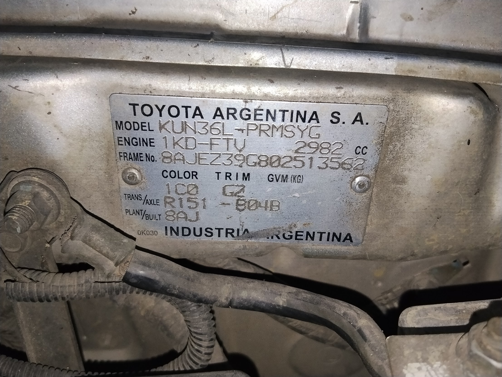
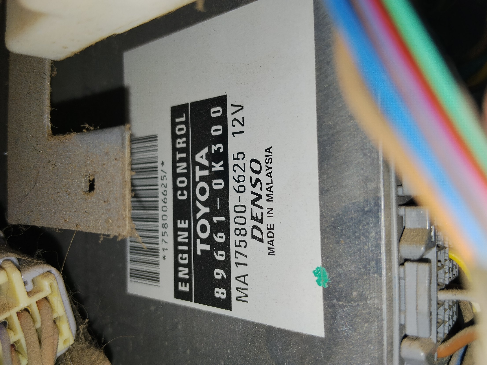
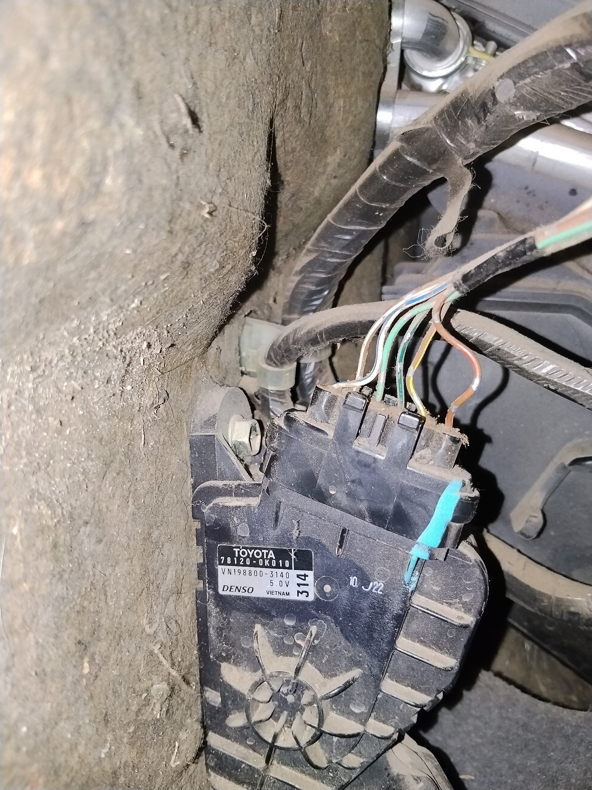
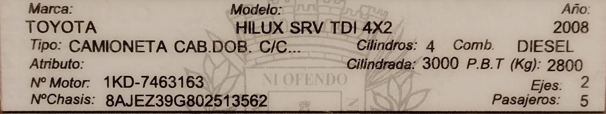

# La placa, Fase 1: leer el pedal y la vibración, y hablarle a la app — plan

> Estado: **plan, nada instalado ni escrito en código.** 13-nov-2026. Las piezas
> todavía no llegaron: el modelo del acelerómetro («creo que es el MPU») y el
> resto de los componentes **se confirman cuando lleguen**, y lo que dependa de
> eso está marcado **A CONFIRMAR**. Escrito por Claude a pedido de Mauro.
>
> Pedido de Mauro, 13-nov-2026: «en una primera etapa… conectar la ESP32 a los
> cables del acelerador en paralelo sin cambiar el circuito para que pueda
> hacer las lecturas y aprender de qué forma está operando». Y después: que las
> muestras no suban en vivo a un chat sino que **se guarden en el mismo soporte
> que usa la aplicación y se exporten junto con los viajes**, y que un
> acelerómetro conectado a la misma placa dé «lecturas más fijas que las del
> teléfono» y **alimente la misma APK**, para cruzar la información «de forma
> segura y consistente».

Este documento **complementa a `CRUCERO.md`** (§ 9, «La placa también le habla
al teléfono») y **cambia una sola decisión** de ese archivo; el § 1 dice cuál.
Su contenido tiene que vivir también en `placa.js` de `maurogasta-crypto/datos`:
**si cambia este archivo, cambia aquél en la misma tanda** (regla de `CRUCERO.md`).

## 1. Qué se decide, y qué cambia respecto de `CRUCERO.md`

**Se decide:** en la Fase 1 la placa **lee** el pedal (VPA y VPA2) **en
paralelo**, con alta impedancia, y lee un acelerómetro propio. **No manda nada**:
no hay relés, no hay DAC, no hay salidas hacia la ECU. Es la etapa 1 del § 7 de
`CRUCERO.md` («escuchar») hecha permanente.

**Lo que cambia.** `CRUCERO.md` § 9.1 decía que la caja básica lee sólo
señales que la camioneta ya da afuera (freno, tacómetro, velocidad) y que
«leer VPA y VPA2 con el arnés en Y pasó a la etapa del crucero». **Mauro lo
adelanta a la Fase 1**, porque lo que se quiere aprender primero es cómo se
comporta el pedal. Es razonable **con tres condiciones**, y sin ellas se vuelve
a la decisión anterior:

1. **Alta impedancia y una resistencia en serie pegada al punto de toma**
   (§ 4.1): la placa no carga la señal ni puede cortocircuitarla.
2. **El tester manda** (§ 8): lo que lee la placa tiene que coincidir con el
   tester antes de dar nada por bueno.
3. **Cualquier luz del motor o código de falla apaga todo**: se desconecta la
   placa y la camioneta queda como de fábrica. Es la prueba de que el paralelo
   no cambió el circuito.

**Lo que NO cambia:** el § 3 de `CRUCERO.md` entero (el teléfono no va en el
lazo del acelerador) y que en la Fase 1 **no existe ninguna salida**. Lo que el
teléfono pueda editar (§ 6.4 de acá) es sólo medida y confort, nunca seguridad.

## 2. Alcance

| Entra en la Fase 1 | No entra |
|---|---|
| Leer VPA y VPA2 en paralelo (alta impedancia) | Emular, cortar o intercalar el pedal (Fase 3) |
| Acelerómetro propio en un punto rígido, 500–1000 Hz (a confirmar con el modelo) | Relés, DAC, watchdog externo, comparador del freno |
| Contexto por optoacopladores: freno (STP), tacómetro (TACH), velocidad (SPD), contacto | Control crucero de cualquier tipo |
| Bluetooth BLE hacia la APK; guardado en la base de la app | Subir datos de la placa a la nube en vivo |
| Respaldo en microSD dentro de la placa | Mensajes del teléfono que cambien algo de seguridad (no existen) |
| Cruce con los viajes ya medidos por la app | Fusionar la vibración de la placa con la del teléfono (se **comparan**, § 7) |

## 3. Las piezas

| Pieza | Para qué | Estado |
|---|---|---|
| ESP32 DevKit en placa de borneras de 38 pines | el cerebro; dos núcleos y BLE | **Ya lo tiene Mauro** (foto 13-nov-2026): módulo «ESP-32 Wi-Fi + Bluetooth», chip USB CP2102, conector USB-C. El rótulo exacto del módulo no se leyó |
| ADC externo ADS1115 (16 bits, I2C) | leer VPA y VPA2: el ADC interno del ESP32 es poco lineal, ruidoso y tolera 3,3 V | A CONFIRMAR |
| Acelerómetro «MPU» (¿MPU6050?) | vibración propia; **sube el techo del espectro de 100 Hz a 500 Hz** (ver `CRUCERO.md` § 9.2) | **A CONFIRMAR modelo** |
| 4 divisores (señal y masa del pedal, por canal): **68 kΩ + 100 kΩ** al 1 % (plan original) **o 56 kΩ + 82 kΩ** (alternativa, § 4.1), + 100 nF en cada entrada | bajar los 5 V del pedal a ≤ 3,1 V sin cargarlo y leer diferencial contra la masa del pedal | **compra pendiente de revisión** (14-nov-2026): la tienda MakerHero no tiene esos valores al 1 %; si se compran de 5 %, se miden y se aparean (8 resistencias, mejor 10 de cada valor) |
| Módulo de 4 optoacopladores (PC817) | freno, tacómetro, velocidad y contacto, aislados | **Ya lo tiene Mauro** (foto 13-nov-2026): rotulado «4 Channel Isolation / 817 Module», con un jumper amarillo por canal. En módulos genéricos así, la entrada tolera 3,6–24 V y el jumper fija el nivel de salida: **se confirma con el tester en la mesa** (qué lado es cuál, resistencias a bordo, efecto del jumper) |
| Módulo microSD (SPI) + tarjeta | respaldo si el Bluetooth se corta | recomendado |
| Reloj DS3231 | alinear sesiones con los viajes si el teléfono no está | opcional |
| Cargador USB de encendedor | alimentación; sólo da corriente con el contacto | a confirmar |
| Fichas macho/hembra del pedal, o una derivación fina soldada | tomar las señales sin cortar | ver § 4.2 |
| Capacitor electrolítico 10 000 µF / 16 V | aguantar la caída de tensión al arrancar (con un diodo en serie) | **Ya lo tiene Mauro**; no hace falta en la Fase 1 |
| Bolsa de diodos axiales | protección contra polaridad invertida / respaldo al arrancar | **Ya los tiene**; el marcado de la bolsa no se pudo leer: **pendiente** |
| 10 resistencias de 10 kΩ, 1/4 W | resistencia en serie de protección y usos generales | **Ya las tiene Mauro** |
| Resistencias de 1 kΩ (o 2 kΩ), 4,7 kΩ y 220/680 Ω/1,5 kΩ; buzzer activo de 5 V | banco de pruebas del mando del volante (§ 4.7) | a comprar (ver `ETAPAS-Y-CAMBIOS.md`) |

**Pasar a Claude, cuando lleguen:** modelo exacto impreso en cada módulo, foto
del chip del acelerómetro y de su plaqueta, y qué dice la etiqueta del ESP32.
Con eso se fija todo lo marcado A CONFIRMAR.

## 4. Conexión eléctrica

### 4.1 El pedal, en paralelo y sin cargarlo

Cada señal (VPA y VPA2) baja por **una resistencia de 68 kΩ puesta en el mismo
punto de toma** y sigue hacia la placa por un cable fino, donde un divisor con
100 kΩ a masa la deja en 0,595 de su valor: **5,1 V → 3,03 V**, dentro de lo
que tolera el ADS1115 alimentado a 3,3 V (su límite es VDD + 0,3 V).

**Par alternativo si no hay de 100 kΩ (14-nov-2026):** **56 kΩ en el punto de
toma y 82 kΩ a masa** dejan la señal en 82 ÷ 138 = **0,594** de su valor,
prácticamente igual a 0,595: 5,0 V → 2,97 V y 4,2 V → 2,50 V, y las constantes
de este documento no cambian. La corriente de falla con la señal en corto sube
de ≈ 75 µA a **5 V / 56 kΩ ≈ 89 µA** y el pedal sigue cargado con unos 36 µA.
Lo que importa es que **las cuatro tomas usen el mismo par**. El factor real se
mide con el tester igual (párrafo siguiente). **Todo esto es propuesta: la compra
está a revisar** y los valores de 1 % no estaban en la tienda consultada.

```
pedal VPA ──┬────────────── a la ECU (no se toca)
            │
          [68 kΩ]  ← pegada al punto de toma
            │
            ├────────[100 nF]── masa de la placa
            ├────────[100 kΩ]── masa de la placa
            │
            └──→ entrada A0 del ADS1115      (VPA2 igual → A1)
```

**Por qué la de 68 kΩ va en el punto de toma y no en la placa:** así el cable que
viaja a la placa lleva ya la señal dividida y, si se pela, se aplasta o se pone
en corto, lo máximo que pasa por la señal original son **5 V / 68 kΩ ≈ 75 µA**.
La ECU no lo nota. **Lo que esto no cubre** es un corto en el punto de toma
mismo, antes de la resistencia: por eso la ventanita se aísla con termocontraíble
y no sólo con cinta, y se comprueba con el tester que no haya continuidad hacia
ningún cable vecino ni hacia el chasis. Es la misma razón por la que `CRUCERO.md` exige que todo
corte sea por cable y no por programa: acá es que **todo fallo caiga del lado
seguro de forma física**.

**La ganancia real no es 0,595:** la impedancia de entrada del ADS1115 y las
tolerancias de las resistencias mueven unas décimas de por ciento. Se **calibra
contra el tester** (contacto puesto, pedal suelto / mitad / a fondo) y esos
factores se guardan con la sesión (§ 6.5), no en el programa.

**La masa del pedal NO se une a la masa de la placa.** La placa se alimenta del
encendedor, o sea que su masa es el chasis; la masa de los sensores del pedal
(EPA) es la que la ECU usa de referencia y puede no estar al mismo potencial.
Unirlas con un cable circula corriente por la masa de los sensores y **mueve la
lectura que hace la ECU**, que es justo lo que se quiere evitar. Por eso cada
canal se lee **diferencial** en el ADS1115: la entrada positiva es la señal
dividida (68 kΩ + 100 kΩ, como arriba) y la negativa es **la masa del pedal por
otro divisor idéntico** (68 kΩ + 100 kΩ a la masa de la placa). El conversor mide
la diferencia entre las dos, y por la masa del pedal sólo pasan los
microamperios que fija esa resistencia: no hay camino de corriente que la
perturbe. Usa los dos pares diferenciales del ADS1115 (A0‑A1 para VPA y A2‑A3
para VPA2). Se mide igual con el tester cuántos mV hay entre EPA y el chasis, y
se anota. **La placa nunca alimenta los sensores del pedal**: los alimenta la
ECU, y ningún cable de la placa se conecta a la alimentación de los sensores.

### 4.2 Cómo se hace la toma

Mauro decidió el 4-nov para las señales de sólo lectura: una ventanita en el
forro, soldada y aislada con buena cinta («pelando un poco el forro»). **Para
las del pedal se recomienda además la opción reversible**: un par de fichas
(macho y hembra) que se intercala y se saca, y la camioneta queda como de
fábrica. Es más cara y más segura, y es lo que se necesita igual en la Fase 3.
**Qué cable es cuál no se supone por el color**: se identifica con el manual de
reparación y se confirma con el tester antes de pelar nada. Los valores que
aparecen en `CRUCERO.md` § 8 son de otro motor Toyota y **no son los del 1KD**.

### 4.2 bis La camioneta, la ECU y el pedal: lo que dicen las etiquetas (13-nov-2026)

Fotos que mandó Mauro el 13-nov-2026 de la etiqueta de la ECU y de la del pedal.
Lo que sigue **copia lo impreso** y le agrega lo que dicen el manual de
reparación y los catálogos de repuestos; **nada de esto está medido en la
camioneta**.

| Pieza | Lo que dice la etiqueta | Qué se sabe |
|---|---|---|
| **ECU** | TOYOTA «ENGINE CONTROL» **89661-0K300**; **MA175800-6625**; 12 V; DENSO; MADE IN MALAYSIA; código de barras 1758006625 | Computadora del motor de la Hilux 1KD-FTV (catálogos de repuestos y foros de inmovilizador la dan para ese motor). **El código no dice el chasis ni el año.** Lleva inmovilizador: cambiarla exige emparejarla (`CRUCERO.md` § 2) |
| **Pedal** | TOYOTA **78120-0K010**; **VN198800-3140**; **5.0 V**; DENSO; VIETNAM; además «314» y «10 J22» (qué significan **no se verificó**; podría ser un sello de fabricación) | «Rod assy, accelerator pedal»: sensor de efecto Hall sin contacto, alimentado con 5 V. Los vendedores lo listan para Hilux 2005-2015 de **todos los motores**, así que **tampoco sirve para fijar el chasis** |
| **Placa del chasis** (vano del motor) | «TOYOTA ARGENTINA S.A.»; MODEL **KUN36L-PRMSYG**; ENGINE **1KD-FTV 2982 cc**; FRAME No. **8AJEZ39G802513562**; COLOR **1C0**; TRIM **GZ** (la foto se lee «G2» o «GZ»); GVM (KG) en blanco; TRANS./AXLE **R151-B04B**; PLANT/BUILT **8AJ**; «0K030» suelto a la izquierda; «INDUSTRIA ARGENTINA» | Ver «Qué dice la placa» abajo |

**Qué dice la placa** (lectura de la foto; el número de chasis tiene un rayón entre
el 9 y la G, se lee 8AJEZ39G802513562 y **tiene 17 caracteres**; conviene
comprobarlo contra la libreta de propiedad):

- **KUN36L-PRMSYG.** La **L** indica volante a la izquierda (las versiones con
  volante a la derecha llevan R). Un catálogo de repuestos da ese código como
  Hilux 1KD-FTV, grado SR, caja manual de 5 marchas, doble cabina, para
  Latinoamérica y armada en Argentina. **Tracción: hay un desacuerdo sin
  resolver.** Por la numeración habitual de Toyota y por la caja R151, el **36**
  sería **4x4**, pero la libreta (abajo) dice **4X2**. Ninguna de las dos
  cosas está confirmada en la camioneta: **A CONFIRMAR** mirando si tiene
  palanca o botón de doble tracción y cardán delantero (importa para la
  vibración: un cardán y una caja de transferencia más).
- **8AJ** es el código de planta (Toyota Argentina) y encabeza el número de
  chasis. **La placa no trae fecha de fabricación**, y el número de chasis no
  la codifica de forma que se pueda leer sin un decodificador. La libreta dice
  **año 2008** (dato del registro, no la fecha de fabricación), dentro del
  «2008-2011» de `README.md`.
- **Caja R151**, no R150F: `CLAUDE.md` calcula las marchas con una **R150F**
  (3,830 · 2,062 · 1,436 · 1 · 0,838) y diferencial 3,583, y dice que es
  «la mejor hipótesis y no un hecho». **La placa dice R151: hay que revisar si
  esas relaciones valen para la R151** y qué relación de diferencial es el
  código de eje **B04B** (la placa no la da). No se tocó ninguna constante de
  la app.
- **Rueda:** el catálogo da para esta versión una 265/70R16; el proyecto usa
  265/70R17 (`MEDICION.md`). Conviene mirar la medida impresa en la cubierta.
- **`CRUCERO.md` habla de KUN26** (los kits, los foros del crucero): **la
  camioneta es KUN36L.** Antes de comprar un kit, preguntar al proveedor si
  sirve para KUN36L; es el mismo motor y casi seguro el mismo pedal, pero no
  está verificado.

**Libreta de propiedad** (Uruguay, foto del 13-nov-2026; **sólo se guardó el
bloque de datos técnicos**, ver la nota al final de esta sección):

| Campo | Dice |
|---|---|
| Marca / modelo | TOYOTA / **HILUX SRV TDI 4X2** |
| Año | **2008** |
| Tipo | CAMIONETA CAB.DOB. C/C… (cortado en la libreta) |
| Cilindros / combustible / cilindrada | 4 / DIESEL / 3000 |
| P.B.T. (kg) | 2800 |
| Nº de motor | **1KD-7463163** |
| Nº de chasis | **8AJEZ39G802513562** (**coincide con la placa**: confirma los 17 caracteres y la lectura del rayón) |
| Ejes / pasajeros | 2 / 5 |

La libreta dice **SRV** y la placa **SR** (grado en el catálogo): puede ser
nomenclatura distinta entre el registro uruguayo y el catálogo de Toyota; no
se resolvió.

**Fotos** (en `fotos/`, tal como las mandó Mauro el 13-nov-2026; la de la ECU
quedó girada 90°, la etiqueta se lee de costado):

| Archivo | Qué muestra |
|---|---|
| `fotos/placa-chasis-KUN36L.jpg` | placa del chasis, vano del motor |
| `fotos/ecu-89661-0K300.jpg` | etiqueta de la ECU |
| `fotos/pedal-78120-0K010.jpg` | pedal con su etiqueta y la ficha con los cables |
| `fotos/libreta-datos-tecnicos.jpg` | recorte de la libreta: sólo marca, modelo, año, motor y chasis |









**Qué no se copió de la libreta, a propósito:** matrícula, padrón, nombre y
documento del titular, y la matrícula anterior. Son datos personales y este
repositorio se distribuye por GitHub. La foto completa queda en el teléfono de
Mauro por si hace falta.

En la foto de la ECU aparecen cables finos de colores (azul, verde, rojo, rosa,
naranja) que no parecen del arnés Toyota, y en la del pedal el arnés está sin
forro cerca de la ficha. **A CONFIRMAR** por Mauro: si son de una intervención
anterior, anotar a dónde va cada uno antes de tomar señales.

**Los seis cables del pedal.** Fuente: Hilux Repair Manual (Argentina,
DR201E) para 1KD-FTV / 2KD-FTV, páginas 05-43 (terminales de la ECU) y 05-188
a 05-195 (códigos P2120…P2138 y su diagrama). **Pendiente de cruzar:** que el
manual cubra la KUN36L y la ECU 89661-0K300 (no se verificó que lo diga); se
confirma con el tester.

| Señal | Pedal (A13) | ECU (E5) | Color | Qué es | Tensión (contacto puesto) |
|---|---|---|---|---|---|
| VCPA | 4 (VCP1) | 26 | verde claro/rojo | alimentación 5 V del sensor 1 | 4,5–5,0 V contra EPA |
| VCP2 | 1 | 27 | marrón/rojo | alimentación 5 V del sensor 2 | 4,5–5,0 V contra EPA2 |
| VPA | 6 (VPA1) | 22 | blanco/azul | señal del sensor 1 (**la que usa el motor**) | 0,6–1,0 V suelto; 2,9–4,2 V a fondo |
| VPA2 | 3 | 23 | gris/verde | señal del sensor 2 (**detecta fallas**) | 1,4–1,8 V suelto; 3,7–5,0 V a fondo |
| EPA | 5 (EP1) | 28 | marrón/blanco | masa del sensor 1 | ≈ 0 V |
| EPA2 | 2 (EP2) | 29 | marrón/amarillo | masa del sensor 2 | ≈ 0 V |

- **Para la placa:** se leen sólo VPA, VPA2, EPA y EPA2. **VCPA y VCP2 no se
  tocan nunca** (§ 4.1: la placa no alimenta los sensores).
- **Son dos masas distintas.** El canal de VPA se lee contra **EPA** y el de
  VPA2 contra **EPA2**, cada una por su divisor; no se cruzan.
- **Si por ahora se lee sin ADS1115** (con el ADC interno del ESP32, § 4.8),
  **EPA y EPA2 casi no valen nada leídas**: con ≈ 0 V y el divisor quedan por
  debajo de unos 0,1 V, donde ese ADC no es confiable. Se mide **con el tester**
  cuántos mV hay entre EPA y el chasis; si son pocos, se ignora la masa del
  pedal y se leen VPA y VPA2 contra la masa de la placa. El diferencial verdadero
  sigue siendo el del ADS1115.
- **Tres cables son marrones** (VCP2, EPA, EPA2) y se confunden: se identifica
  cada uno con el tester y con el número grabado en la ficha, no por el color.
- **Lo que la ECU considera falla** (según el manual): VPA fuera de 0,2–4,8 V
  más de 0,5 s; VPA2 fuera de 0,5–4,8 V más de 0,5 s; y VPA y VPA2 con
  diferencia de 0,02 V o menos durante 2 s (se interpreta como corto entre
  ambas, P2138). Un puente de soldadura entre cables vecinos se ve como esto.
- **Identificar con el tester** (contacto puesto, motor apagado, punta negra al
  chasis, sondeando por atrás de la ficha con puntas finas): los dos que dan
  ≈ 0 V fijos son masas; los dos con 4,5–5 V fijos son alimentaciones; los dos
  que cambian al pisar son las señales (arranca más bajo VPA). Para emparejar
  cada masa y cada alimentación con su sensor, el manual usa continuidad menor
  a 1 Ω entre cada pin del pedal y su pin de la ECU, con el contacto apagado y
  las dos fichas desconectadas.
- **No se desconecta la ficha del pedal con el contacto puesto** (graba código).

### 4.3 El acelerómetro

- Alimentado a 3,3 V desde el ESP32, por I2C (SDA/SCL), con su pin de
  «dato listo» (INT) a un pin del ESP32. La dirección I2C se fija con AD0
  (típico 0x68 para un MPU6050).
- **Atornillado a un punto rígido** (nunca con cinta ni adhesivo blando) y
  **siempre con la misma orientación**. La orientación se anota con la sesión.
- **Al arrancar, el firmware lee el registro de identidad (WHO_AM_I)** y lo
  manda a la app. Un MPU6050 original responde 0x68, un MPU6500 0x70 y un
  MPU9250 0x71, y **los módulos baratos suelen traer chips falsos o
  parecidos**: se guarda lo que responda, para no descubrir tres semanas
  después que los registros eran otros.
- Rango inicial ±4 g (unos 0,12 mg por paso en un MPU6050) y filtro interno
  puesto; **la frecuencia medida es la que se guarda, no la pedida** (§ 6.5).

### 4.4 Contexto por optoacopladores

Freno (STP), tacómetro (TACH), velocidad (SPD) y contacto entran por un módulo
de optoacopladores ya armado, aislados de la camioneta. Un pedal solo no dice si
el pie sube por un adelantamiento o por una cuesta: freno, RPM y velocidad
**dan el contexto sin el cual la lectura del pedal no se puede interpretar**.

### 4.5 Alimentación y arranque

Cargador USB de encendedor (sólo con contacto). **Al dar arranque, la tensión
cae y el ESP32 puede reiniciarse**: en la Fase 1 es aceptable y se espera. La
sesión se cierra, la placa vuelve y abre otra, y la app la reconoce como una
reconexión (§ 6.3). La fuente automotriz con protección contra picos queda para
cuando la placa mande sobre algo (`CRUCERO.md` § 9.1).

### 4.6 Pines (propuesta; se fija al armar, con las piezas en la mano)

| Función | Pin del ESP32 |
|---|---|
| I2C SDA / SCL (ADS1115 y acelerómetro) | 21 / 22 |
| INT del acelerómetro | 4 |
| microSD: CS / SCK / MISO / MOSI | 5 / 18 / 19 / 23 |
| STP / TACH / SPD / contacto (entradas con pull-up) | 32 / 33 / 25 / 26 |
| LED de estado (**única** salida) | 2 |

**Regla por construcción:** en la Fase 1 **ningún pin es una salida hacia la
camioneta**. Las únicas salidas son el LED, el CS de la microSD y, en el banco
de pruebas del mando (§ 4.7), **un buzzer que no se conecta a nada del
vehículo**. El banco de pruebas lo comprueba mirando el firmware: cualquier
salida fuera de esa lista rompe la prueba. *(Cambio del 14-nov-2026: se agregó
el buzzer; antes la lista era LED y CS.)*

### 4.7 El mando del volante y un buzzer: banco de pruebas (propuesta, 14-nov-2026)

**Objetivo.** Comprobar, sin intervenir nada, que el joystick de crucero ya
instalado está bien conectado y que **no genera órdenes falsas**, antes de que
mande sobre algo del vehículo. El ESP32 lee el mando y un buzzer suena según
el botón: es un banco de pruebas, no un control.

**Qué se sabe del mando (ninguna cifra medida en esta camioneta).** Según el
manual de reparación de una Hilux (generación que **no se verificó** que sea la
de Mauro) la palanca da, medida a masa: **principal ON < 1 Ω; RES/ACC
216–264 Ω; SET/COAST 567–693 Ω; CANCEL 1386–1694 Ω; reposo ≥ 10 kΩ (abierto)**.
Un foro de Corolla 2006 da casi lo mismo (210–270 / 560–700 / 1380–1700 Ω). **Otro
modelo (Land Cruiser) usa otra escalera** (60–70 / 180–220 / 380–460 Ω), y la
palanca de Mauro puede ser de cualquiera o no ser Toyota: **manda lo que mida el
tester en cada posición** (`CRUCERO.md` § 4, Fase 0, paso 2). El manual nombra dos
cables por el resorte del volante: CCS (señal) y ECC (retorno).

**Por qué el pull-up no puede ser de 10 kΩ.** Con valores de unos cientos de
ohms y 10 kΩ a 3,3 V, los tres botones darían 0,08 V, 0,20 V y 0,44 V: donde el
ADC del ESP32 lee mal y no se distinguen. Con **1 kΩ** (o 2 kΩ) quedan separados.

| Posición | R a masa (referencia) | con pull-up 1 kΩ | con pull-up 2 kΩ |
|---|---|---|---|
| principal ON | ≈ 0 Ω | 0 V | 0 V |
| RES | ≈ 240 Ω | 0,64 V | 0,35 V |
| SET | ≈ 630 Ω | 1,28 V | 0,79 V |
| CANCEL | ≈ 1,5 kΩ | 2,00 V | 1,44 V |
| reposo (abierto) | ∞ | 3,3 V | 3,3 V |

(V = 3,3 × R ÷ (R + pull-up); con el ADC interno solo valen 0,15–2,5 V
aproximadamente, por eso conviene el pull-up de 1 kΩ.)

**Cable cortado vs reposo.** Con reposo abierto, un cable cortado se ve igual
que reposo. Se resuelve con una **resistencia de fin de línea** en paralelo en
el extremo de la palanca (4,7 kΩ como punto de partida, se calcula con lo medido).
Con 1 kΩ de pull-up daría: reposo 2,72 V; RES 0,61 V; SET 1,18 V; CANCEL 1,77 V;
**cable cortado 3,3 V** (distinto de reposo); **corto a masa 0 V** (se parece al
botón principal, y no hay forma de separarlos con esta lectura).

**Reglas del firmware de prueba (propuestas, se ajustan con las primeras mediciones)**

- Una banda de voltaje por botón, con margen; lo que cae entre bandas no cuenta.
- Un botón sólo se acepta si la lectura se mantiene en su banda **unos 30–50 ms**,
  y hay que pasar por reposo antes de aceptar otro.
- Una lectura fuera de todas las bandas más de un instante es **falla** y suena
  distinto. Sonidos distintos por botón; la falla suena continua.
- Pull-up, resistencia en serie de protección y un capacitor de 100 nF cerca del
  pin. **Antes de conectar: medir 0 V en el cable** (con 12 V se quema el pin).

**Pruebas contra falsos positivos (criterios propuestos)**

1. En la mesa, resistencias fijas en lugar de la palanca, unos 50 pulsos por
   botón: ninguno se confunde.
2. Con la palanca real, sin tocar botones: mover el cable, golpear el volante y
   girar de tope a tope (resorte del volante): **no debe sonar nada**.
3. Camioneta con contacto puesto y luego en marcha, con luces y ventilador
   (ruido del alternador).
4. En ruta con baches y mucho giro, registrando lectura cruda y eventos:
   **cero eventos falsos en varias horas** (el número se fija).

**Pines (propuesta):** el mando entra por un **pin ADC1** (no ADC2: los de ADC2 no
sirven para analógico mientras haya radio) y el buzzer sale por un pin
digital a través de un módulo con transistor o un NPN con 1 kΩ en la base.

### 4.8 Primera lectura del pedal con el ADC interno (exploratoria, sin ADS1115)

Si se quiere ver las curvas antes de comprar el ADS1115: los 4 divisores
(§ 4.1) + 100 nF en cada entrada, y los pines **ADC1** del ESP32 (VP, VN, D34 y
D35, para VPA, EPA, VPA2 y EPA2). **Limitaciones, todas esperadas:** el ADC interno
no es lineal (más en los extremos), tiene ruido de decenas de mV y hay que
calibrarlo contra el tester. Sirve para ver la forma de las curvas, la relación
entre VPA y VPA2 y cómo se mueven con el pie; **no** para mediciones de
precisión. Con esta lectura, los pines propuestos en § 4.6 para STP/TACH/SPD
(32/33/25/26) chocan con D32/D33 si se usan para el mando: se reasignan al armar.

## 5. Lo que hace el firmware

- **Dos núcleos:** uno lee sensores y sella el tiempo; el otro habla por
  Bluetooth y escribe la microSD. Un cuelgue del Bluetooth no frena la lectura.
- **El tiempo se sella en la placa, en el instante de la muestra** (con el INT
  del acelerómetro y el reloj de microsegundos del ESP32), **nunca cuando el
  teléfono recibe el paquete**: el BLE tiene variación de demora y, si se sella
  del otro lado, el espectro se deforma.
- **Acelerómetro:** lee el FIFO del chip y manda lotes. El objetivo es 1 kHz
  con el filtro interno puesto, para que lo que está arriba de 500 Hz no se
  pliegue sobre lo medido (el mismo problema que ya documentó `MEDICION.md`
  con el teléfono a 200 Hz). **A CONFIRMAR** con el modelo y con la frecuencia
  que realmente entregue.
- **Pedal:** unas 100 muestras por segundo de cada canal, alternando entradas
  del ADS1115. Se manda el **valor crudo del conversor**, no milivoltios: el
  factor de calibración vive en el registro de la sesión (§ 6.5) y se puede
  rehacer después sin perder nada.
- **Digitales:** estado del freno y contacto con su instante, y pulsos de
  tacómetro y velocidad **contados por el hardware** (no por el programa).
- **Respaldo en microSD:** las mismas tramas que van por Bluetooth, en un
  archivo por sesión. Si el teléfono se cae, **no se pierde nada** y la app pide
  lo que le faltó al reconectar. Una herramienta (que escribe Claude) las
  convierte a CSV para analizarlas fuera de la app.

## 6. Bluetooth: cómo le habla la placa a la APK

### 6.1 BLE, no Bluetooth clásico

BLE consume menos, el ESP32 lo da completo y es lo que mejor soportan los
plugins de Flutter. Con 1 kHz × 3 ejes × 2 bytes son **unos 6 kB/s** más unos
0,4 kB/s del pedal: cabe con lotes de ~20 ms y un MTU negociado de 185–247
bytes. **Si en el Redmi Note 9 no se sostiene**, se baja a 500 Hz (y la placa
sigue guardando completo en la microSD). Eso se mide en la primera prueba, no
se supone.

### 6.2 La interfaz GATT

Un solo servicio de la placa, con cuatro características. **Los UUID de 128 bits
se generan una vez y se fijan en el firmware, en la app y en `placa.js`**; no se
inventan en este documento.

| Característica | Sentido | Qué lleva |
|---|---|---|
| Datos | placa → app (notificación) | tramas de acelerómetro, pedal y digitales |
| Estado | placa → app (lectura/notificación) | versión del firmware, WHO_AM_I, frecuencias medidas, tramas perdidas, hora de la placa, causa del último reinicio |
| Tiempo | lectura/escritura | sincronización de relojes (§ 6.3) |
| Control | app → placa (escritura) | **sólo** los parámetros del § 6.4 |

**Seguridad de la conexión:** emparejamiento con clave (vinculación) y **una sola
conexión central a la vez**. La app sólo acepta la placa que se emparejó. El
Control exige estar emparejado. La Fase 1 no tiene salidas, así que **un mensaje
malicioso o equivocado no puede mover nada del vehículo**: lo peor que puede
hacer es desordenar una medición, y por eso todo cambio queda escrito (§ 6.4).

### 6.3 Un solo reloj

La placa tiene su propio reloj monótono en microsegundos; la app, el del
teléfono. Para cruzarlos:

- Al conectar, y cada cierto tiempo, la app lee el reloj de la placa varias
  veces y guarda el **desfase con la menor demora de ida y vuelta**.
- **Los datos crudos se guardan en el tiempo de la placa** y el desfase se
  guarda **aparte, como una tabla de puntos** (tiempo de la placa → tiempo del
  teléfono). Al leer, se convierte. Es la regla de siempre —**los derivados no
  se guardan**— y evita que un sincronizado mejorado mañana sea imposible
  porque el de hoy ya se «horneó» en las muestras.
- Un reinicio de la placa (el arranque, § 4.5) abre **una sesión nueva** con
  su propio desfase.

### 6.4 Lo que el teléfono puede editar, y lo que no

Es el § 9.3 de `CRUCERO.md`, sin cambios:

- **Sí:** cada cuánto manda cada señal, rango y filtro del acelerómetro,
  umbrales para pedir una grabación. Con tres condiciones: el firmware **recorta
  cada parámetro a su rango**, un cambio **que altera cómo se mide** se acepta
  **sólo con el vehículo detenido**, y **queda escrito de los dos lados** (la
  placa anota qué cambió y cuándo; la app lo guarda con el viaje). Un número
  tocado que nadie anotó vuelve incomparables todos los viajes siguientes.
- **No:** nada de seguridad. En la Fase 1 no existe en la placa, y en la Fase 3
  vive en el hardware y el firmware, sin mensaje que lo cambie.

### 6.5 La trama

Todas las tramas llevan lo mismo adelante y un control al final:

| Campo | Bytes | Para qué |
|---|---|---|
| marca y versión del formato | 2 | reconocer y poder cambiar el formato sin romper lo viejo |
| tipo | 1 | acelerómetro, pedal, digitales, estado |
| número de secuencia | 4 | **detectar tramas perdidas**: un salto es un faltante y se guarda |
| tiempo de la primera muestra (µs de la placa) | 8 | sellado en la placa |
| tiempo hasta la última muestra (µs) | 4 | **la frecuencia medida de cada trama = (n−1) / ese intervalo**; esa se guarda |
| n de muestras | 2 | |
| muestras | n × (6 o 4) | acelerómetro: x, y, z; pedal: VPA, VPA2 (crudos) |
| CRC | 2 | una trama dañada se descarta y se cuenta |

**Registro de la sesión** (la app lo guarda al abrir cada una): versión del
firmware, modelo y WHO_AM_I del acelerómetro, rango y filtro, **factor de
calibración de cada canal del pedal** (y contra qué tester se calibró), el
desfase de reloj y su historia, y la orientación del montaje.

## 7. En la app

### 7.1 Plugin y permisos

Falta todo esto, y **el zip del 4-nov no lo trae** (no hay plugin Bluetooth en
`pubspec.yaml` ni permisos en el manifiesto; el `enlace.dart` que existe habla
con la Pizarra del otro teléfono, no con la placa):

- Plugin BLE de Flutter **a elegir y verificar la versión al hacer la tanda**
  (candidato: `flutter_blue_plus`).
- **Android 10 (el Note 9, `minSdk 29`)**: el escaneo BLE exige el permiso de
  ubicación, que la app ya pide por el GPS. **Android 12 en adelante**: exige
  `BLUETOOTH_SCAN` y `BLUETOOTH_CONNECT`. El Redmi 15 y el Note 9 se comportan
  distinto; **se prueba en los dos**.
- **HyperOS:** la conexión tiene que vivir dentro del servicio en primer plano
  que ya existe (`CLAUDE.md`, § MIUI/HyperOS), no en uno aparte: un servicio
  Bluetooth que el sistema mata en segundo plano es la forma más segura de
  perder muestras sin darse cuenta.

### 7.2 Dos fuentes nuevas, con la forma que ya existe

- **`FuenteDeVibracion`** ya es la interfaz del acelerómetro y emite `Sacudon`
  (tiempo, x, y, z). **La placa es otra implementación de esa interfaz**, y
  todo el motor de análisis (espectro, bandas, líneas, línea base) funciona sin
  tocarse. Es lo que ya prevé `CRUCERO.md` § 9.2 («el motor de análisis no tiene
  que saber de dónde salen los números»).
- **Una interfaz nueva para el pedal** (`FuenteDePedal`), con el mismo
  criterio: **el banco de pruebas tiene que poder conducir una camioneta sin
  camioneta**. Se hace una fuente falsa que reproduce un CSV de una sesión
  (la herramienta del § 5 los genera), y las pruebas corren sin hardware.

### 7.3 Dónde se guarda

Se sigue la regla del esquema: **nunca se edita una migración publicada; se
agrega una abajo y sube `versionEsquema`** (hoy 13, así que la de la placa sería
la 14, **a confirmar contra el repositorio vivo** el día que se haga).

Tablas propuestas (nombres y columnas **a revisar** al implementar):

- **`placa_sesiones`**: una por conexión de la placa, con el registro del § 6.5
  y a qué viaje pertenece (puede no haber viaje).
- **`placa_pedal`**: el pedal **crudo y completo**, en bloques (un BLOB por
  intervalo, no una fila por muestra). A 100 Hz son unos **1,4 MB por hora**.
- **`placa_digitales`**: freno, contacto y conteos, con su instante.
- **`placa_vibracion`**: lo derivado del acelerómetro con el **mismo formato de
  ventana que `vibraciones`** (bandas, picos, líneas), con `origen = 'placa'`.
- **Grabaciones crudas de 10 s del acelerómetro de la placa**, con el mismo
  mecanismo que ya tiene `grabaciones` (cuando una línea se sale o cuando se
  toca «Grabar»), en lugar de guardar todo: a 1 kHz son unos **21 MB por hora**
  y no entran en una copia de la base.

**Decisión pendiente de Mauro (§ 10):** guardar el **pedal completo** y el
acelerómetro **derivado + grabaciones de 10 s** es lo que se recomienda, porque
lo que se quiere aprender del pedal es justamente su comportamiento fino, y el
espectro del acelerómetro ya se resume bien en bandas y líneas.

### 7.4 Exportación y nube

- **Todo viaja con los viajes**: entra en la copia completa de la base y en la
  importación, que **suma sin reemplazar**. Cada tabla nueva se agrega al
  importador, al saneado y a sus pruebas **en la misma tanda**: una tabla que
  se puede sacar y no devolver es un error que este proyecto ya pagó.
- **La nube:** los reportes se resumen (porcentajes de pedal por zona, relación
  VPA2/VPA, tramas perdidas, frecuencias medidas); **no se suben las muestras
  del pedal a Firestore** (un documento no pasa de 1 MiB, y hay un cupo). Los
  1,4 MB por hora quedan en el teléfono y en la copia completa de la base.
- **Nunca coordenadas** en nada de la placa, como en el resto del proyecto.
- **Todo lo que mide la placa va marcado como de la placa** y **no se presenta
  como dato de la ECU**: es una tensión leída en un cable, no un mensaje del
  vehículo.

### 7.5 Cruce con los viajes, sin mezclar

- **La placa es otra clase de muestreo.** Sus ventanas **no se comparan con las
  del teléfono** y la línea base de la placa **se aprende desde cero**, igual
  que pasó con los 50 y los 200 Hz de `sitd-42`.
- **La frecuencia guardada es la medida, no la pedida.**
- **Los dos acelerómetros del viaje se COMPARAN, no se fusionan**
  (el criterio de «Tres teléfonos en el mismo viaje», `MEDICION.md`): cuando el
  teléfono y la placa ven el mismo evento, se mide cuánto coinciden. Es la
  primera prueba de que la placa agrega valor y de que el sincronizado de
  reloj sirve.
- **Lo que no se borra sigue contando** si la placa se desconecta a mitad de un
  viaje: el viaje se mide igual con el teléfono, y el hueco de la placa queda
  marcado como faltante.

**Preguntas que esto permite responder** (y que hoy no se pueden): cómo se
relaciona el pedal con las RPM contadas y con el consumo del tramo; si hay
vibración que sólo aparece con carga alta de pedal; si el camino áspero se
separa de «motor haciendo fuerza» (`CRUCERO.md` § 9.2, «Posición del pedal»);
y cuánto se parecen VPA y VPA2 entre sí, que es **el dato que hay que tener
antes de diseñar la Fase 3**.

## 8. Pruebas, por etapas (no se saltea ninguna)

0. **En la mesa, sin camioneta.** ESP32, ADS1115 y acelerómetro alimentados
   por USB, con un potenciómetro que simula el pedal. Se comprueba la lectura
   del ADC contra el tester, el divisor, y el Bluetooth hasta la app (con la
   fuente falsa y con la real). **Primera medición de si el Note 9 sostiene el
   flujo.**
0 bis. **Banco del mando (§ 4.7).** Resistencias fijas (≈ 220 Ω, 680 Ω, 1,5 kΩ)
   y un buzzer: calibración de bandas, filtro de rebotes y la alarma de falla.
   **Sin camioneta.**
0 ter. **Módulo de optoacopladores en la mesa:** 12 V desde una batería o una
   fuente, con un pulsador; se comprueba qué lado es la entrada, qué hace el
   jumper y qué ve el ESP32.
1. **En la camioneta, motor apagado, contacto puesto.** Primero **medir con el
   tester** VPA y VPA2 con el pedal suelto, a la mitad y a fondo. Después
   conectar la placa y repetir: **los valores de la placa tienen que
   coincidir con el tester** (**±20 mV es un punto de partida propuesto, se
   fija con la primera medición**). **Mirar el tablero:** ninguna luz.
2. **Motor en marcha, en ralentí, freno de mano.** La luz del motor sigue
   apagada y las RPM siguen al pie como siempre.
3. **Viajes cortos.** La camioneta anda **exactamente igual** que sin la placa.
4. **Viajes normales: aprendizaje.** Recién acá se miran los datos para
   aprender.

**Si en cualquier etapa aparece una luz o un código de falla** (el típico es el
de las dos señales del pedal que no se corresponden, **P2135**, que ya se vio
en intentos caseros con Arduino, `CRUCERO.md` § 8): **se desconecta la placa**
y se vuelve a la etapa anterior. Que la camioneta quede como de fábrica con
sólo sacar la placa es la prueba de que la conexión en paralelo **no cambió el
circuito**.

## 9. Lo que puede salir mal

| Riesgo | Qué lo cubre |
|---|---|
| La ECU ve la placa y marca falla en el pedal | Alta impedancia, 68 kΩ en el punto de toma, tester antes y después, y desconexión inmediata |
| Diferencia de masa entre el pedal y el chasis | Lectura diferencial: la masa del pedal entra por un divisor de alta impedancia y **nunca se une a la masa de la placa** (§ 4.1) |
| Un cable mal identificado (12 V, o la alimentación de los sensores, llega a una entrada) | Cada entrada pasa por 68 kΩ pegada a la toma (limita la corriente), se identifica con manual y tester **antes** de pelar, y se verifica con la placa desenchufada |
| La placa apagada con las señales del pedal presentes | Entra una corriente de decenas de µA por los diodos de protección del conversor y puede mantener alimentada la placa a medias: se **desconectan las tomas** al dejar la camioneta con la placa fuera, o se agrega un diodo en la entrada (a decidir con el modelo exacto) |
| Picos del alternador por el encendedor | Cargador de buena marca; la fuente automotriz con protección de picos queda para cuando la placa mande algo |
| Chip de acelerómetro distinto del esperado | Se lee y guarda WHO_AM_I; los registros se verifican al arrancar |
| El Bluetooth se corta o HyperOS lo mata | Respaldo en microSD, número de secuencia, la conexión dentro del servicio en primer plano |
| El reloj de la placa se desfasa del teléfono | Tabla de puntos de sincronización y datos crudos en el tiempo de la placa |
| Reinicio de la placa al dar arranque | Es esperado: sesión nueva, la app lo reconoce |
| Ruido de encendido o de alternador | Capacitores en las entradas, montaje del acelerómetro, y se **mira** en las primeras mediciones |
| La base crece demasiado | Pedal en bloques (1,4 MB/h), acelerómetro derivado, grabaciones de 10 s con tope diario |
| Un parámetro tocado que nadie anotó | Todo cambio queda escrito en la placa y en la app |

**Seguro y habilitación:** la Fase 1 sólo lee, pero igual se está conectando un
cable a una señal de mando del vehículo. Conviene dejar la toma **reversible**
(las fichas del § 4.2) y **preguntar antes de la Fase 3**, como ya dice
`CRUCERO.md` § 5.

## 10. Lo que hay que decidir o traer (Mauro)

1. **Los modelos exactos** de lo que llegue (ver § 3), con fotos.
2. Si la microSD entra en la Fase 1 (se recomienda).
3. **Pedal completo + acelerómetro derivado** (lo que se recomienda) o todo
   completo en el teléfono (§ 7.3).
4. Fichas reversibles o derivación soldada para el pedal (§ 4.2).
5. Si el reloj DS3231 entra o se usa sólo el del teléfono.
6. **Qué dicen los diodos** de la bolsa (el marcado no se leyó en la foto).
7. **Resistencias de los botones del joystick** medidas con el tester (§ 4.7).
8. **Cuál par de divisores** se compra y con qué tolerancia (68/100 kΩ al 1 %
   o 56/82 kΩ de 5 % apareadas), y si MakerHero envía a Uruguay.
9. **¿4x2 o 4x4?** La libreta dice 4X2 y la placa (KUN36 + caja R151) sugiere
   4x4: mirar si hay palanca/botón de doble tracción y cardán delantero.
10. **¿Caja R151 o R150F?** `CLAUDE.md` calcula con R150F; la placa dice R151.

## 11. Qué archivos toca esto cuando se implemente (la tanda)

- **Nuevo:** `lib/features/placa/` (fuente BLE, tramas, sesión, sincronizado de
  reloj, fuente falsa para el banco) y sus pruebas en `test/`.
- **`lib/core/db/esquema.dart`:** una migración nueva abajo y `versionEsquema`
  +1; `test/esquema_test.dart` la revisa.
- **`importar.dart`, `reporte.dart`, `saneado.dart`** y sus pruebas: cada tabla
  nueva sale y vuelve a entrar.
- **`pubspec.yaml`, `AndroidManifest.xml`:** el plugin BLE y los permisos.
- **`lib/core/version.dart`:** el sello de la tanda.
- **`README.md` y `CLAUDE.md`:** una fila en la tabla de documentación técnica
  y una regla corta que apunte a este archivo.
- **`placa.js` en `maurogasta-crypto/datos`**, en la **misma tanda**.

**Cambios que este documento pide en `CRUCERO.md`:**

- § 9.1, donde dice «**No toca el pedal**: leer VPA y VPA2 con el arnés en Y
  pasó a la etapa del crucero», poner: «**No lo comanda**: lee VPA y VPA2 en
  paralelo y de alta impedancia desde la Fase 1 (Mauro, 13-nov-2026; ver
  `PLACA-FASE-1.md`). Lo que pasó a la etapa del crucero es cortarlas e
  intercalarlas».
- Donde el mismo párrafo dice «La placa de sensores **no toca el pedal**, así
  que puede existir antes», cambiar a «no **comanda** el pedal».

**Para `CLAUDE.md`, la fila del índice:**

| `PLACA-FASE-1.md` | la Fase 1 de la placa (13-nov-2026): leer el pedal en paralelo y un acelerómetro propio, cómo se conecta, cómo le habla a la APK por BLE, dónde se guarda y cómo se cruza con los viajes sin mezclar |

## Fuentes y lo que no se verificó

- Lo que dice este documento de la app sale de leer el zip del repositorio del
  4-nov-2026 (`sitd-57`, esquema 13): **si cambió desde entonces, hay que
  revisarlo antes de implementar.**
- Los números de las piezas (impedancias, rangos, direcciones, pines) son
  **valores típicos de las hojas de datos de cada chip, no medidos en esta
  camioneta**: se confirman con las piezas en la mano.
- **Los valores de `CRUCERO.md` § 8 no son del 1KD**: son de otro motor Toyota.
  Desde el 13-nov-2026 el § 4.2 bis trae los del manual de reparación de la
  Hilux/1KD-FTV (Argentina, DR201E), que **tampoco están medidos en esta
  camioneta**: se miden (`CRUCERO.md` § 6 y § 8).
- **Mando del volante (§ 4.7):** valores del manual de reparación de una Hilux
  (http://skcmspvtltd.org/agh/m/toyota/hilux/repair2/html/contents/rm000000plu004x.html,
  que **parece de una generación más nueva** que la KUN36), del foro
  https://www.toyotanation.com/threads/06-corolla-cruise-control-not-working.426686/
  y de un Land Cruiser (https://lc100e.github.io/pdf/rm/rm616e/m_di_0736.pdf,
  que da **otros** valores). Ninguno es el de la camioneta de Mauro.
- **Módulo de optoacopladores:** fichas de módulos genéricos (p. ej.
  https://myduino.com/product/jhs-122/ y https://oe2.open-electronics.org/?p=46325);
  el de Mauro puede diferir.
- **Divisores 56/82 kΩ:** cálculo propio (0,594); no está probado en el pedal.
- Documento que resume los cambios y las etapas: `ETAPAS-Y-CAMBIOS.md`.
